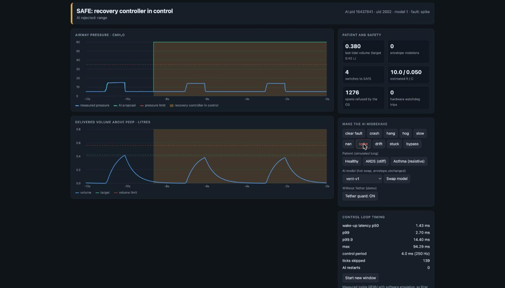

# Tether

**Runtime assurance for an AI controller, on QNX 8.0.** An untrusted neural network drives a
simulated ventilator. A small verified arbiter sits between the network and the blower, and the
operating system keeps the network from going around it.

> **The lung is simulated.** Tether is a research prototype for the QNX Global Hackathon (category
> Robotics & Medical). It is not certified, not a medical device, and makes no clinical claim.



*The `spike` fault: the AI proposes 70 cmH₂O (green, off the top of the chart). The arbiter rejects it as out of range and the verified recovery controller keeps the simulated patient at about 14 cmH₂O (blue).*

## The problem

Learned controllers are good at tracking a target and bad at proving they will never do something
dangerous. Regulators and safety standards still ask for that proof. The usual answer is a *Simplex*
architecture (ASTM F3269 calls the roles input manager, safety monitor, switch and recovery
controller): let the complex controller do the work, and let a simple one you can verify take over the
moment it misbehaves.

Tether builds that on QNX, where the guarantees can come from the operating system and not from
good behaviour inside one process.

## What it does

```
        proposals                          verified recovery controller
 ┌───────────────┐   MsgSend     ┌──────────────────────────────────────┐
 │  tether-ai    │──────────────▶│ tether-arbiter                       │  devctl   ┌────────────┐
 │  (MLP, uid    │◀──────────────│  monitor → switch → actuator         │──────────▶│ tether-hw  │
 │   2002, no    │  observation  │  250 Hz timer pulse, SCHED_FIFO 60   │◀──────────│ /dev/tether│
 │   abilities)  │               └──────────────────────────────────────┘  sensor   │ blower+lung│
 └──────▲────────┘                    ▲ status, telemetry                           └────────────┘
        │ faults, model swap          │
 ┌──────┴──────────────────────┐   ┌──┴───────────┐
 │ tetherd (restarts the AI)   │   │ tether-bridge│── HTTP :8080 ── dashboard
 └─────────────────────────────┘   └──────────────┘
```

* The AI proposes a pressure. The arbiter applies it only if it passes the envelope: fresh, finite,
  in range, not rising too fast, no pressure during expiration, and a lookahead through the lung
  model (using compliance and resistance estimated from the sensors, never from the AI) that says the
  breath will stay under the volume limit.
* If a proposal fails, a verified recovery controller takes over. The AI is readmitted only at a
  breath boundary after a run of healthy proposals.
* The AI is a *client* of the arbiter, never its server. A hung AI cannot block the control loop; a
  dead AI is reported by the kernel itself.
* The actuator device is root-only. The AI runs as another user with its abilities locked, so a
  bypass attempt is refused by the kernel, and counted.

## Where QNX matters

Everything below is exercised by [`tools/qemu/selftest.sh`](tools/qemu/selftest.sh), which runs on
the live system inside the QNX image and prints PASS or FAIL.

| QNX feature | What Tether uses it for | Code | Seen working |
|---|---|---|---|
| Resource manager (`resmgr`, `iofunc`, `devctl`) | The virtual blower and flow sensor as `/dev/tether/{sensor,actuator,plant}` | [`qnx/hw/tether-hw.c`](qnx/hw/tether-hw.c) | `ls -l /dev/tether`: actuator `crw-------`, plant `crw-rw----` (group 2000), sensor `cr--r--r--` |
| Kernel permission check on `open()` | The AI's user cannot open the actuator; the hardware counts refusals | same | `on -u 2002 tether-ctl actuate 20` → `Permission denied`; 298 refusals in 6 s under the `bypass` fault |
| `procmgr_ability` + `setuid` | The AI and the dashboard start as root, lock away spawn, fork, setuid, physical memory, I/O and more, then become unprivileged | [`qnx/ai/tether-ai.c`](qnx/ai/tether-ai.c), [`qnx/bridge/tether-bridge.c`](qnx/bridge/tether-bridge.c) | log: `now uid 2002 gid 2002, abilities locked` |
| Message passing (`MsgSend/Receive/Reply`, `name_attach`) | AI → arbiter proposals; dashboard → arbiter and AI | [`qnx/arbiter/tether-arbiter.c`](qnx/arbiter/tether-arbiter.c) | closed loop at 250 Hz |
| Disconnect pulse (`_PULSE_CODE_DISCONNECT`) | The arbiter learns an AI process died without polling it | `ipc_loop()` in the arbiter | log: `AI disconnected (kernel disconnect pulse)` |
| Timer pulses, `SCHED_FIFO`, priority-inheriting mutex | A control loop that keeps its timing while the AI saturates every CPU | `control_thread()`, [`qnx/hw/tether-hw.c`](qnx/hw/tether-hw.c) | `top` during the `hog` fault: 99% CPU busy, two AI threads at ~48% each, arbiter still running; latency table below |
| `TimerTimeout` + a helper thread | Calls into the arbiter carry a deadline. Calls into the untrusted AI go through a helper thread, because a deadline cannot release a client that is reply-blocked on a channel with `_NTO_CHF_UNBLOCK` (every `name_attach` channel) unless the server answers | [`qnx/bridge`](qnx/bridge/tether-bridge.c), [`qnx/tetherd`](qnx/tetherd/tetherd.c) | with the AI's control channel made silent, the first call gave up after 0.4 s, the status page still answered in 8 ms, and later calls failed in ~2 ms (`tools/qemu/gateway-test.sh`) |
| `posix_spawn`, `waitpid`, `SIGKILL` | A supervisor restarts a crashed AI and turns a hung one into a crash | [`qnx/tetherd/tetherd.c`](qnx/tetherd/tetherd.c) | log: `AI silent for 1.2 s: killing pid …`, then a restart |
| `slog2` | Structured logs of every switch | [`qnx/common/qcommon.c`](qnx/common/qcommon.c) | `slog2info` shows `tether` buffer |
| `mkqnximage` + QEMU | One image that boots straight into Tether | [`tools/qemu`](tools/qemu), [`qnx/image`](qnx/image) | dashboard answers about 12 s after boot |

## Results

Measured on QNX SDP 8.0 (`QNX 8.0.0 2026/06/05 QEMU_virt aarch64le`) inside QEMU 11.1.3 on an Apple
M4 Mac, with the control loop at 250 Hz. Full method and caveats in [`docs/results.md`](docs/results.md).

**Faults.** `selftest.sh`: 29 checks, all pass, covering `spike`, `nan`, `stuck`, `drift`, `bypass`, `hog`,
`crash`, `hang`, a model swapped in at run time, a patient who changes from healthy to ARDS to asthma,
the AI's user being refused every operator action, the arbiter and the hardware being killed, and the
same fault with the guard turned off.
Outside that last deliberate test there were **zero** violations of the envelope. With the guard off,
the same `spike` fault produced 1,249 ticks over the limits.

**Timing.** Wake-up latency of the 4 ms control tick, in separate 25 s windows (µs):

| window | p50 | p99 | p99.9 | max |
|---|---|---|---|---|
| idle | 1250 | 2010 | 3490 | 8234 |
| AI saturating both CPUs | 1140 | 1910 | 11600 | 30994 |
| AI spamming refused opens | 1230 | 2000 | 2400 | 4456 |
| AI too slow (40 ms per inference) | 1280 | 2060 | 7970 | 54042 |

The AI stress does not move the median or the 99th percentile. The maxima are emulator and host
noise: they appear in an idle window too. These numbers say nothing about real hardware.

**Simulation on the host** (no QNX needed): 775 unit checks; a hostile AI fuzzed for 2.4 million ticks
never exceeded the envelope (peak 27.9 cmH₂O against 35, 0.466 L against 0.56). In the fault campaign
a `spike` drives the AI alone to 70 cmH₂O and 3.25 L; behind Tether the peak is 15 cmH₂O and 0.417 L.

## Run it

**On the host** (macOS or Linux, any C11 compiler and CMake): the portable core, the simulator and
the tests.

```
cmake -S . -B build && cmake --build build && ctest --test-dir build --output-on-failure
build/host/tether-sim --model models/vent-v1.tmlp --campaign
```

**On QNX 8.0** (needs a free QNX Everywhere licence, see [`docs/running.md`](docs/running.md)):

```
tools/docker/build-image.sh            # build container with the QNX host tools (x86_64 Linux)
tools/docker/install-sdp.sh <qsc.run>  # QNX Software Center + SDP 8.0 (interactive, you accept the licence)
tools/qemu/build-image.sh              # cross-compile and build the bootable image
tools/qemu/run-vm.sh start             # boot it under QEMU
open http://localhost:8080             # the dashboard
tools/qemu/selftest.sh                 # the pass/fail checks
```

## Honest limits

* The patient is a single-compartment lung model. Nothing here has touched a real patient or a real
  ventilator, and no part of it is certified.
* A drift inside the envelope is caught only when the lookahead predicts a violation, which can take
  several breaths. The monitor protects the safety limits; it does not promise the AI is accurate.
* The recovery controller is deliberately simple (fixed 9 cmH₂O above PEEP). It is safe for every lung
  the envelope allows, and under-ventilates a stiff one.
* QEMU runs here under software emulation because its Apple-silicon accelerator stops in the QNX
  kernel start-up. The loop is 250 Hz, not the 1 kHz the defaults assume, and timings reflect the
  emulator.
* The dashboard has no authentication. It is a lab demo behind a forwarded localhost port.

## Layout

| Path | What |
|---|---|
| `core/` | Portable C11 with no I/O and no allocation in the control path: arbiter, lung model, estimator, MLP, real-time primitives |
| `host/`, `tests/` | Closed-loop simulator, data generator, 775-check test suite |
| `qnx/` | The QNX processes: `hw`, `arbiter`, `ai`, `bridge`, `tetherd`, `ctl`, the dashboard, and the image inputs |
| `tools/` | Container, image, VM, self-test and training tooling |
| `models/` | Shipped models (`.tmlp`): a good one, a second one, and a deliberately biased one for the hot-swap demo |
| `docs/` | [architecture](docs/architecture.md), [results](docs/results.md), [running](docs/running.md), [Devpost images](docs/devpost/README.md) |

Licensed under Apache-2.0.
